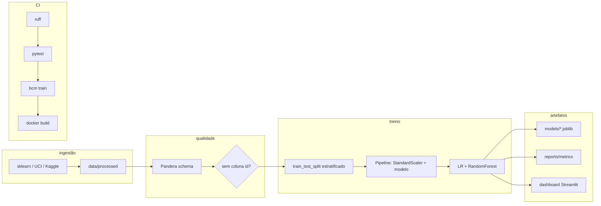

# Breast Cancer ML Pipeline

**Eric Guerrize** · Data Engineer · portfólio de ML end-to-end

Pipeline reprodutível de classificação no clássico **Breast Cancer Wisconsin (Diagnostic)** (UCI / Kaggle / `sklearn.datasets.load_breast_cancer`): ingestão → validação de schema → treino com `Pipeline` sklearn → métricas → artefatos → dashboard Streamlit → CI.

> **Não é um dispositivo médico.** Uso estritamente educacional / demonstração de engenharia de ML.

---

## Problema

Classificar tumores de mama como **malignos** ou **benignos** a partir de 30 features numéricas derivadas de imagens digitalizadas de aspiração por agulha fina (FNA) do núcleo celular.

Mesmo com ~569 linhas, o foco deste repositório é **engenharia**: layout de pacote, CLI, validação, anti-vazamento, testes, Docker e CI — não um notebook solto.

## Dataset e citação

- **Nome:** Breast Cancer Wisconsin (Diagnostic)
- **Origem:** UCI Machine Learning Repository; espelho Kaggle [`uciml/breast-cancer-wisconsin-data`](https://www.kaggle.com/datasets/uciml/breast-cancer-wisconsin-data); também via `sklearn.datasets.load_breast_cancer`
- **Citação:** Wolberg, W. H., Street, W. N., & Mangasarian, O. L. *Breast Cancer Wisconsin (Diagnostic)*. UCI Machine Learning Repository.
- **Encoding sklearn:** `0 = malignant`, `1 = benign` (no CSV UCI/Kaggle: `M` / `B`)
- **Ingestão padrão (CI / offline):** `sklearn` — **sem credenciais Kaggle**
- Opcional: download HTTP UCI (`--source uci`) ou `kaggle datasets download` se `KAGGLE_USERNAME` / `KAGGLE_KEY` estiverem definidos

## Arquitetura



## Como rodar (2 comandos)

```bash
make setup
make demo
```

Isso instala o pacote editável com extras de desenvolvimento e executa ingestão → validação → treino → predição smoke **100% offline** (fonte `sklearn`).

### Comandos úteis

| Comando | Descrição |
|---------|-----------|
| `make lint` | Ruff check + format |
| `make test` | Pytest |
| `make train` | Treina e grava artefatos |
| `make dashboard` | Streamlit em `0.0.0.0:$PORT` |
| `make docker-build` | Imagem Docker |
| `bcm ingest --source sklearn` | Só ingestão |
| `bcm validate` | Schema + anti-ID |
| `bcm predict` | Predição pontual |

CLI: `bcm` (Typer).

## Layout

```
src/breast_cancer_ml/   # pacote (ingestion, validation, training, cli)
data/raw/               # gitignored
data/processed/         # saída da ingestão
notebooks/              # EDA leve (opcional)
models/                 # joblib (regenerados no train/CI)
reports/                # métricas + figuras
dashboard/              # Streamlit
tests/
docs/
.github/workflows/      # ruff, pytest, train, docker
```

## Ética e limitações

- **Não use para decisão clínica.** Este projeto não foi validado como produto de saúde.
- Dataset **clássico e pequeno** (~569 amostras, 30 features): ótimo para pipeline/demo, fraco como proxy de performance no mundo real (drift, população, aquisição de imagem, etc.).
- Métricas altas são esperadas neste benchmark; o valor do portfólio está na **engenharia reprodutível**, não no leaderboard.
- Para um companheiro mais forte de **Data Engineering**, veja o projeto de mortalidade **DATASUS** (ingestão pública em escala, qualidade de dados e orquestração).

## Stack

Python 3.11+ · scikit-learn · pandas · pandera · Typer · pytest · ruff · Streamlit · SHAP (opcional) · Docker · GitHub Actions · MLflow opcional (`BCM_USE_MLFLOW=1`)

## Licença

MIT © Eric Guerrize
